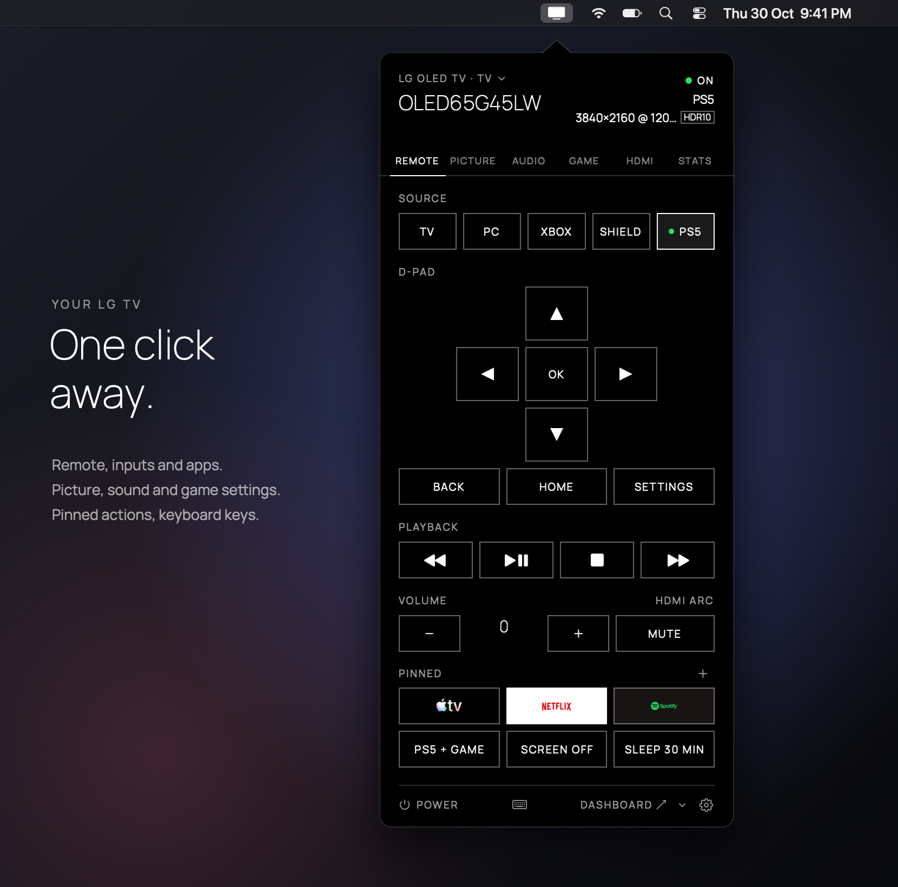
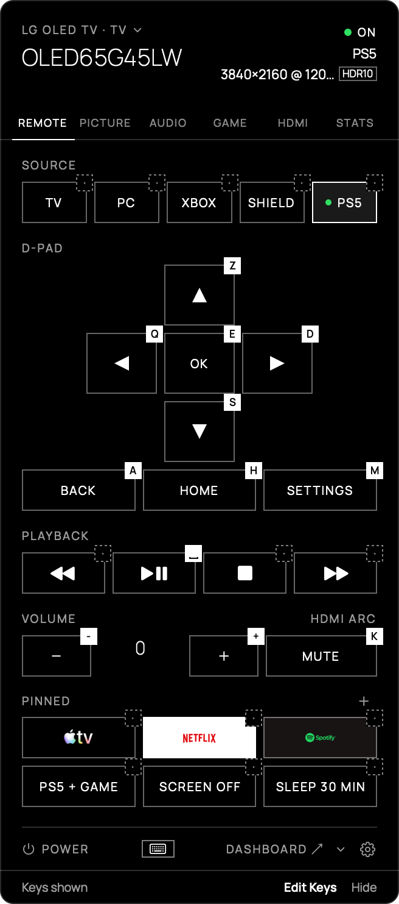
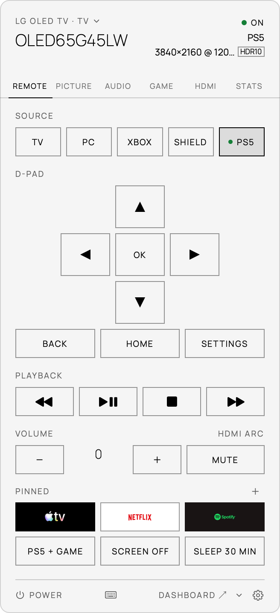
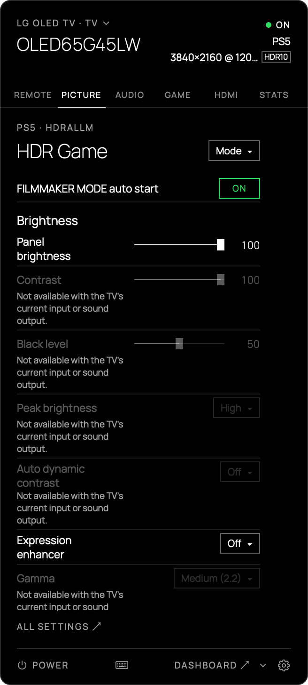
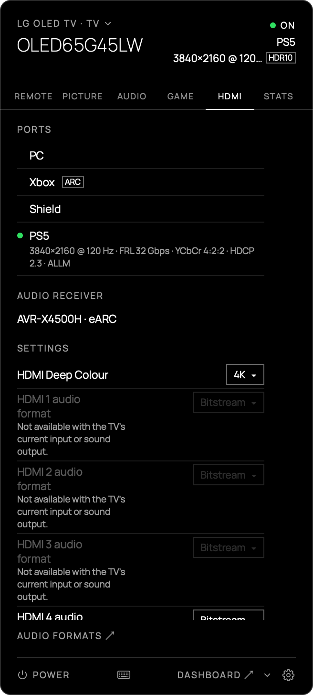
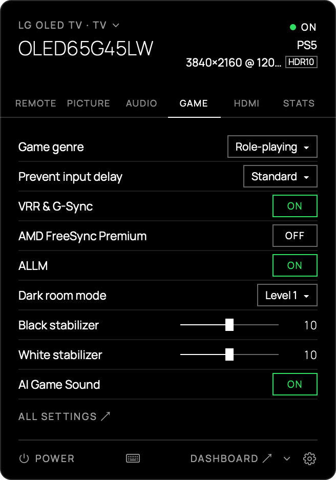
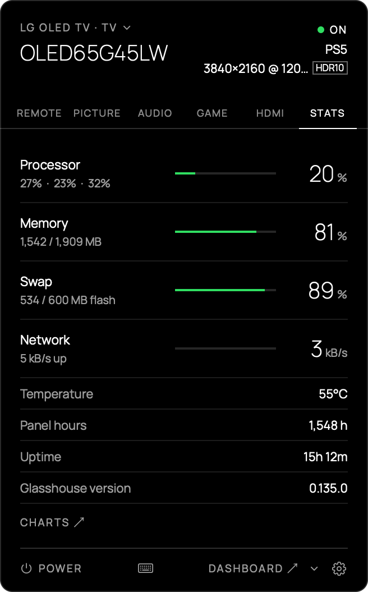
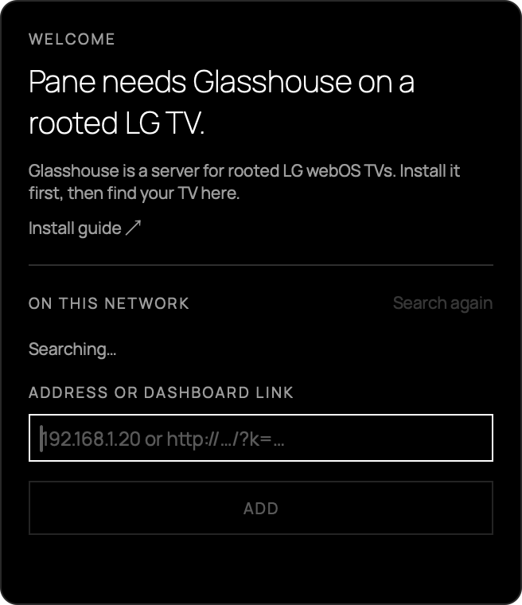

<p align="center"></p>

# Pane for Glasshouse

A macOS menu-bar remote for an LG webOS TV running [Glasshouse](https://github.com/rorygallagher2024/glasshouse): remote control, sources, Picture, Audio and Game settings, HDMI ports and metrics, without opening the web dashboard. The rest of the dashboard opens from a link, on the right tab.

<p align="center"></p>

- Keyboard remote while the popover is open: Arrows and Gaming profiles (by key position, whatever the keyboard layout), and every key can be changed in a Custom profile kept apart.
- Pinned items: a setting or a sequence of actions on the Control tab, with its own key. A pin that launches an app can show the app's icon.
- Settings are drawn from what the server sends, so a setting added on the server appears without updating the app.
- Power from any state: on, Active Standby, LG's Always Ready screen, and Wake-on-LAN for a TV in deep standby.
- Several TVs, dark and light themes, English and French.

## Screenshots

<table>
  <tr>
    <td align="center" valign="top"><br><sub>Keyboard keys shown on every button</sub></td>
    <td align="center" valign="top"><br><sub>Light theme</sub></td>
  </tr>
  <tr>
    <td align="center" valign="top"><br><sub>Picture settings, as the TV sends them</sub></td>
    <td align="center" valign="top"><br><sub>HDMI ports, receiver and settings</sub></td>
  </tr>
  <tr>
    <td align="center" valign="top"><br><sub>Game settings</sub></td>
    <td align="center" valign="top"><br><sub>Live statistics</sub></td>
  </tr>
</table>

## Install

```sh
brew install --cask denisvinciguerra/tap/pane-for-glasshouse
```

Or download the DMG from the [releases](https://github.com/denisvinciguerra/pane-for-glasshouse/releases) and drag Pane to Applications.

## Requirements

- macOS 14 (Sonoma) or later.
- An LG webOS TV running Glasshouse (port 8080 by default).

## Adding a TV

On first launch the popover opens by itself and looks for TVs on the network (SSDP, then the Mac's subnet on port 8080). Otherwise, type the TV's address (for example `192.168.1.20`; port 8080 by default) or paste a dashboard link: its `k=` parameter carries the token.



macOS asks for local network access the first time Pane searches. If it was denied, Pane says so and points to System Settings › Privacy & Security › Local Network.

With several TVs, the ⌄ menu in the header switches TV, and Preferences › TV manages them.

## Updates

Pane uses [Sparkle](https://sparkle-project.org). It checks once a day by default; change this in Preferences › General › Updates (Check automatically, Check Now). When an update is found while Pane is not in front, you get a system notification, a dot on the menu-bar icon and a bar in the popover. Installing opens Sparkle's window with the release notes.

## Privacy

- A TV's token is only ever sent to that TV's saved address. If the TV changed IP address, Pane looks for it without any token and sends the token only to the host whose MAC address matches: the one in the Mac's ARP table or, when the table has none for that host, the one in the server's stats. Pane only looks for a TV saved by an IP address on the Mac's current network, and waits longer between searches while it stays lost (5, 15, then 60 minutes).
- Tokens are stored in the macOS keychain.
- To find TVs (on the add screen, or when a saved TV stops answering on the same network), Pane sends an SSDP search and probes the Glasshouse port (8080 by default) on the Mac's local subnet. Apart from that and Sparkle's update checks to GitHub (the appcast and, when you install an update, the DMG), it only talks to your TVs. No telemetry.

## Building

```sh
brew install xcodegen
xcodegen generate
xcodebuild -project Pane.xcodeproj -scheme Pane -configuration Release -scmProvider system build
swift test --package-path PaneKit
```

The testable logic is in the `PaneKit` package; the app (`App/`) is SwiftUI. Local builds are ad hoc signed. `-scmProvider system` avoids a keychain prompt when Xcode resolves Sparkle. Releases (Developer ID, notarized) are made with `scripts/release.sh`. A source build and the released app are signed differently, so after switching from one to the other macOS asks once per saved token for access to the keychain.

## Contributing

See [CONTRIBUTING.md](CONTRIBUTING.md). Security issues: [SECURITY.md](SECURITY.md). Changes between versions: [CHANGELOG.md](CHANGELOG.md).

## Credits

- [Glasshouse](https://github.com/rorygallagher2024/glasshouse) by Rory Gallagher (MIT). The test fixture `PaneKit/Tests/PaneKitTests/Fixtures/ui.html` is a recorded copy of its dashboard page, under the same licence.
- [Manrope](https://github.com/googlefonts/manrope), SIL Open Font License (`App/Resources/Fonts/OFL.txt`).
- [Sparkle](https://sparkle-project.org) (MIT).

## Disclaimer

An independent project, not affiliated with or endorsed by LG Electronics or the Glasshouse project. webOS is a trademark of LG Electronics. Pane sends commands to your TV, including power; use it at your own risk.

## License

MIT, see [LICENSE](LICENSE).
