<p align="center">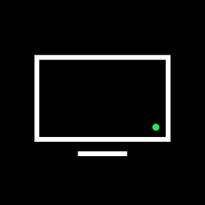</p>

# Pane for Glasshouse

A remote for an LG webOS TV running [Glasshouse](https://github.com/rorygallagher2024/glasshouse), on the Mac (in the menu bar), iPhone and iPad: remote control, sources, Picture, Audio and Game settings, HDMI ports and metrics, without opening the web dashboard. The rest of the dashboard opens from a link, on the right tab.

<p align="center"><a href="https://apps.apple.com/app/id6830095172"><strong>iPhone and iPad: App Store</strong></a> · <a href="#install"><strong>Mac: Homebrew or DMG</strong></a></p>

<p align="center">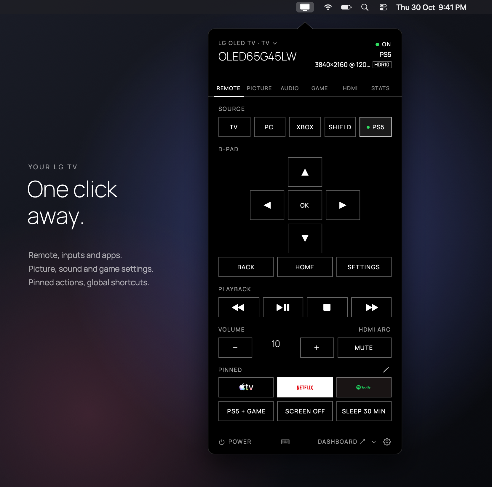</p>

- Settings are drawn from what the server sends, so a setting added on the server appears without updating the app.
- Pinned items: a setting or a sequence of actions on the Remote tab. A pin that launches an app can show the app's icon. Triggered while the TV is off, it turns the TV on first.
- Power from any state: on, Active Standby and LG's Always Ready screen. On the Mac, also Wake-on-LAN for a TV in deep standby ([not yet on iPhone and iPad](#iphone-and-ipad)).
- Several TVs, dark and light themes, English and French.

On the Mac:

- Keyboard remote while the popover is open: Arrows and Gaming profiles (by key position, whatever the keyboard layout), and every key can be changed in a Custom profile kept apart.
- Global shortcuts: a key combination for a button, an input, an action or a pinned item that works in any app, with a small card under the menu-bar icon.

## Screenshots

On iPhone and iPad, shown here with the app's demo TV:

<table>
  <tr>
    <td align="center" valign="top">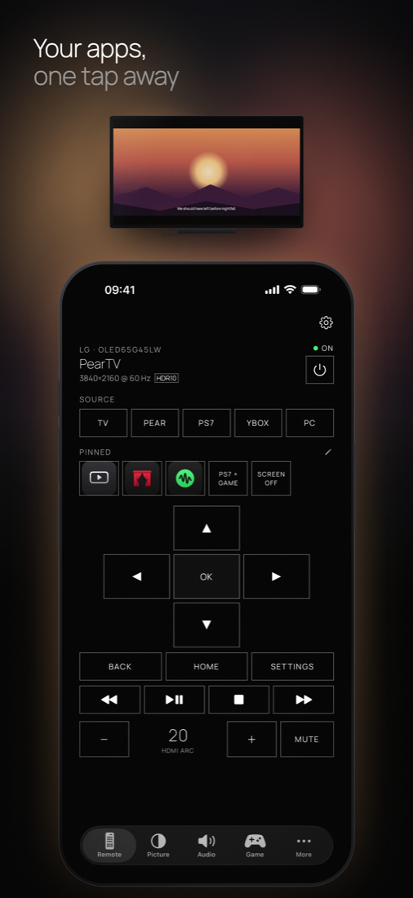<br><sub>The whole remote on one screen</sub></td>
    <td align="center" valign="top">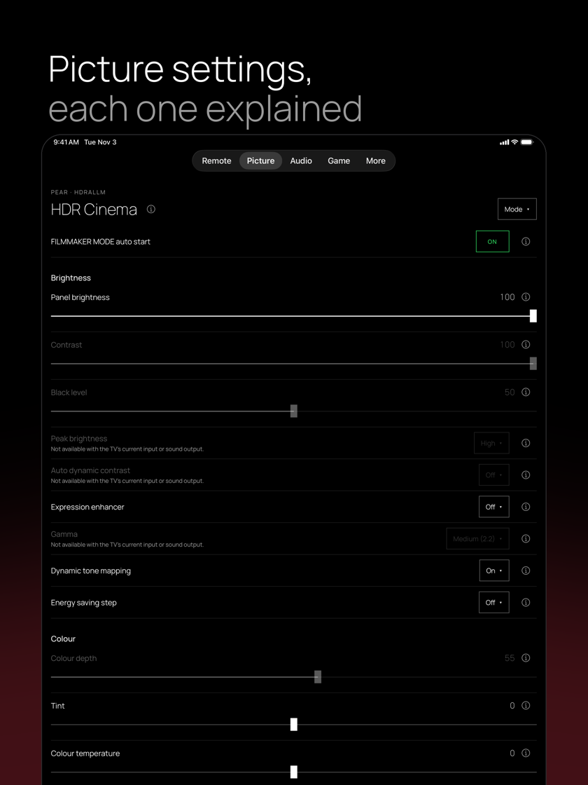<br><sub>Picture settings on iPad</sub></td>
  </tr>
</table>

On the Mac:

<table>
  <tr>
    <td align="center" valign="top">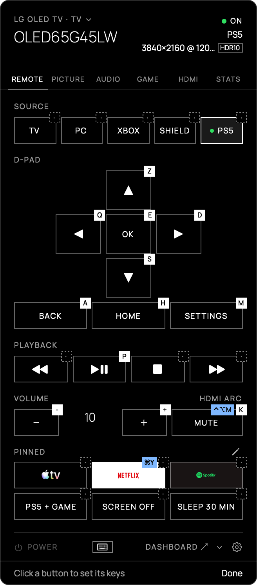<br><sub>Keys and global shortcuts, set from the bottom bar</sub></td>
    <td align="center" valign="top">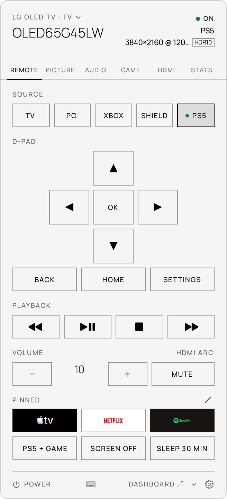<br><sub>Light theme</sub></td>
  </tr>
  <tr>
    <td align="center" valign="top">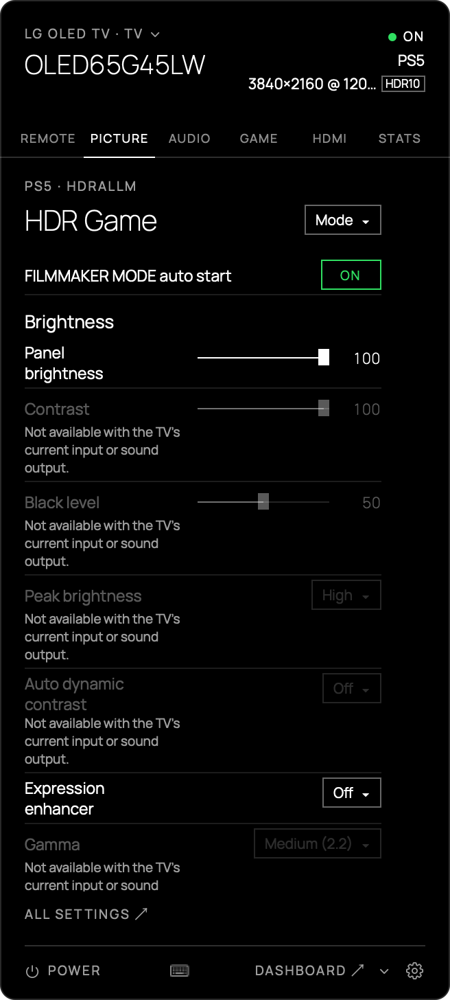<br><sub>Picture settings, as the TV sends them</sub></td>
    <td align="center" valign="top">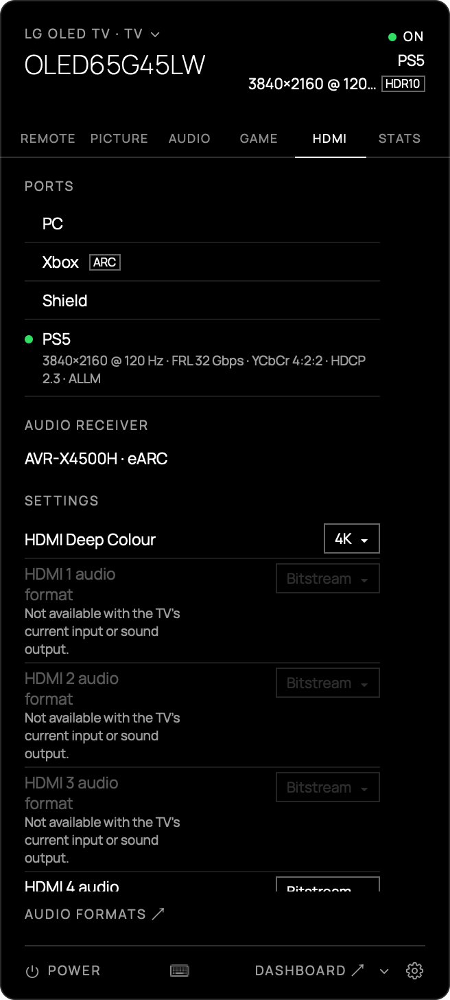<br><sub>HDMI ports, receiver and settings</sub></td>
  </tr>
  <tr>
    <td align="center" valign="top">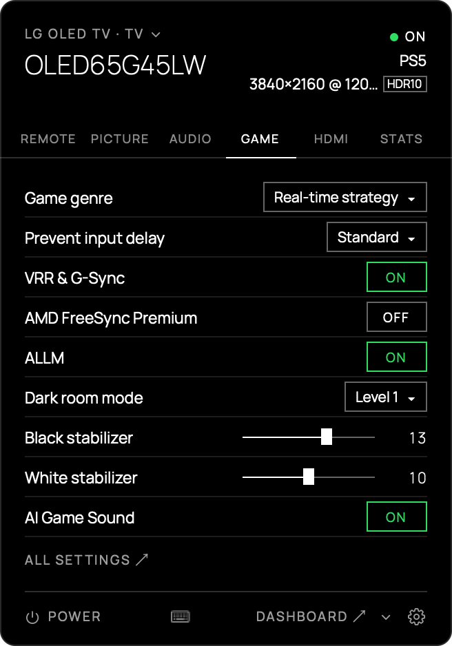<br><sub>Game settings</sub></td>
    <td align="center" valign="top">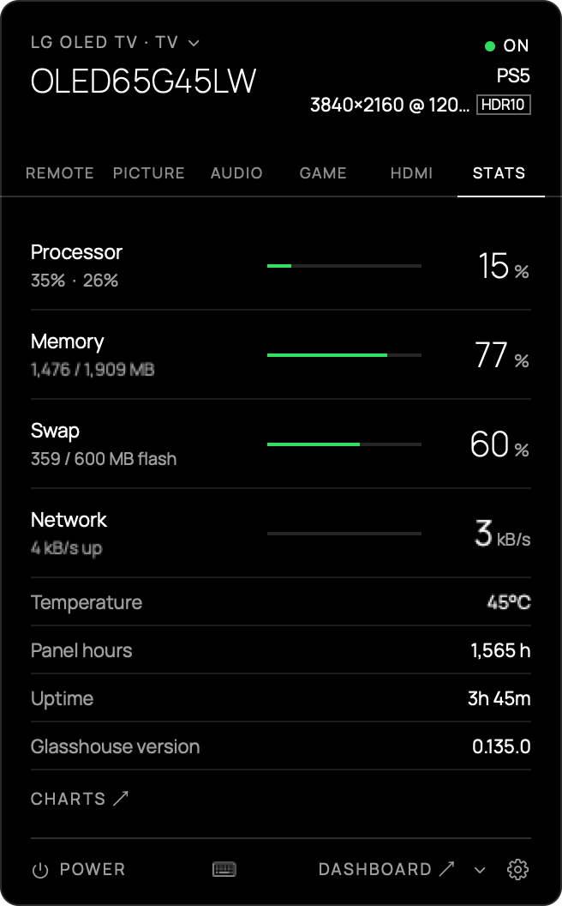<br><sub>Live statistics</sub></td>
  </tr>
</table>

## Install

**iPhone and iPad:** [Pane for Glasshouse on the App Store](https://apps.apple.com/app/id6830095172), free.

**Mac:**

```sh
brew install --cask denisvinciguerra/tap/pane-for-glasshouse
```

Or download the DMG from the [releases](https://github.com/denisvinciguerra/pane-for-glasshouse/releases) and drag Pane to Applications.

## Requirements

- macOS 14 (Sonoma) or later, or iOS 17 or later (iPhone and iPad).
- An LG webOS TV running Glasshouse (port 8080 by default).

## Adding a TV

On first launch Pane shows a welcome screen and looks for TVs on the network. On the Mac, the popover opens by itself and searches by SSDP, then on the Mac's subnet on port 8080; on iPhone and iPad, see [below](#iphone-and-ipad). Otherwise, type the TV's address (for example `192.168.1.20`; port 8080 by default) or paste a dashboard link: its `k=` parameter carries the token.

<p align="center">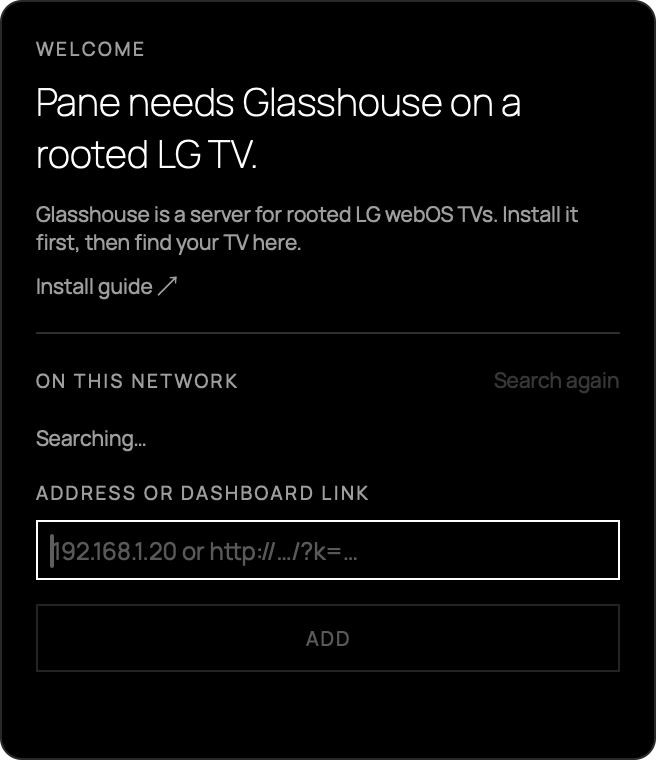</p>

macOS asks for local network access the first time Pane searches. If it was denied, Pane says so and points to System Settings › Privacy & Security › Local Network.

With several TVs on the Mac, the ⌄ menu in the header switches TV, and Preferences › TV manages them.

## iPhone and iPad

The same remote, for the couch: sources, pinned apps and actions, the pad and volume on one screen, Picture, Audio, Game, HDMI and Stats under tabs, and the other TVs as chips showing what they are doing (reading only). Pane for Glasshouse is [on the App Store](https://apps.apple.com/app/id6830095172), free; updates come from the App Store.

- iPhone: the remote fits one screen. iPad in landscape: two columns, the remote on the right by default (Settings › Remote column › Left swaps them). Portrait, Split View and Slide Over use the iPhone layout.
- Settings are touch-friendly, with an ⓘ that explains each one. The pins editor reorders by dragging a tile.
- With a hardware keyboard on an iPad, the Arrows, Gaming and Custom profiles work while Pane is in front.
- No global shortcuts, no menu-bar icon and no hardware volume buttons: iOS offers no equivalent for an app like this. Pane does nothing in the background.
- "Try without a TV" (on the welcome screen and in Settings) runs the whole app against a demo TV.
- iOS asks for local network access the first time Pane searches for a TV.
- Tokens are stored in the iOS keychain. There is no iCloud sync: each device is set up on its own.

What differs from the Mac:

- **A TV with a token that changed address must be found again by hand.** iOS does not let an app read the ARP table, so nothing proves which host carries the TV's MAC address, and the token is never sent to an unproven host. Pane says the TV is not found and offers to search again or to type the new address. A TV saved without a token is still found again by its MAC address.
- **Wake-on-LAN and SSDP search need an entitlement from Apple** (multicast networking). Without it Pane finds TVs by sweeping the subnet on the Glasshouse port, or by the address you type, and it can turn on a TV in Active Standby or Always Ready over the network. To wake a TV from deep standby, keep it in Active Standby (Quick Start+ or Always Ready in the TV's settings); Pane says so when the wake-up is refused.

## Updates

On iPhone and iPad, updates come from the App Store.

On the Mac, Pane uses [Sparkle](https://sparkle-project.org). It checks once a day by default; change this in Preferences › General › Updates (Check automatically, Check Now). When an update is found while Pane is not in front, you get a system notification, a dot on the menu-bar icon and a bar in the popover. Installing opens Sparkle's window with the release notes.

## Privacy

- A TV's token is only ever sent to that TV's saved address. If the TV changed IP address, the Mac app looks for it without any token and sends the token only to the host whose MAC address matches: the one in the Mac's ARP table or, when the table has none for that host, the one in the server's stats. It only looks for a TV saved by an IP address on the Mac's current network, and waits longer between searches while it stays lost (5, 15, then 60 minutes). iOS cannot read the ARP table, so on iPhone and iPad a TV with a token is found again by hand.
- Tokens are stored in the macOS keychain (the iOS keychain on iPhone and iPad). The iOS app collects no data: no telemetry, no account, no iCloud.
- To find TVs (on the add screen, or when a saved TV stops answering on the same network), Pane probes the Glasshouse port (8080 by default) on the device's local subnet; the Mac app also sends an SSDP search. Apart from that and, on the Mac, Sparkle's update checks to GitHub (the appcast and, when you install an update, the DMG), it only talks to your TVs. No telemetry.

## Building

```sh
brew install xcodegen
xcodegen generate
xcodebuild -project Pane.xcodeproj -scheme Pane -configuration Release -scmProvider system build
swift test --package-path PaneKit
```

The testable logic is in the `PaneKit` package. The Mac app is in `App/`, the iPhone and iPad app in `iOSApp/`, and what they share (the model, theme and views) in `Shared/`; all SwiftUI. The iOS app builds with `xcodebuild -project Pane.xcodeproj -scheme "Pane iOS" -destination 'generic/platform=iOS Simulator' CODE_SIGNING_ALLOWED=NO build` (a device build needs your own signing team). Local builds are ad hoc signed. `-scmProvider system` avoids a keychain prompt when Xcode resolves Sparkle. Releases are signed with a Developer ID and notarized by the maintainer. A source build and the released app are signed differently, so after switching from one to the other macOS asks once per saved token for access to the keychain.

## Contributing

See [CONTRIBUTING.md](CONTRIBUTING.md). Security issues: [SECURITY.md](SECURITY.md). Changes between versions: [CHANGELOG.md](CHANGELOG.md).

## Credits

- [Glasshouse](https://github.com/rorygallagher2024/glasshouse) by Rory Gallagher (MIT). The test fixture `PaneKit/Tests/PaneKitTests/Fixtures/ui.html` is a recorded copy of its dashboard page, under the same licence.
- [Manrope](https://github.com/googlefonts/manrope), SIL Open Font License (`Shared/Resources/Fonts/OFL.txt`).
- [Sparkle](https://sparkle-project.org) (MIT).

## Disclaimer

An independent project, not affiliated with or endorsed by LG Electronics or the Glasshouse project. webOS is a trademark of LG Electronics. Pane sends commands to your TV, including power; use it at your own risk.

## License

MIT, see [LICENSE](LICENSE).
